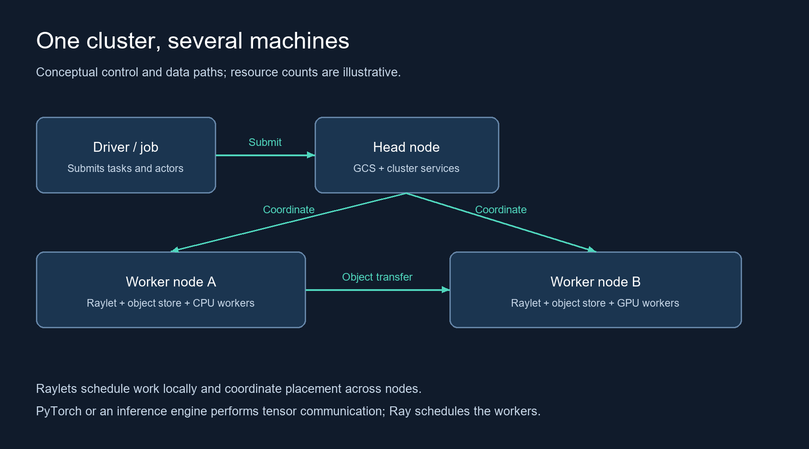
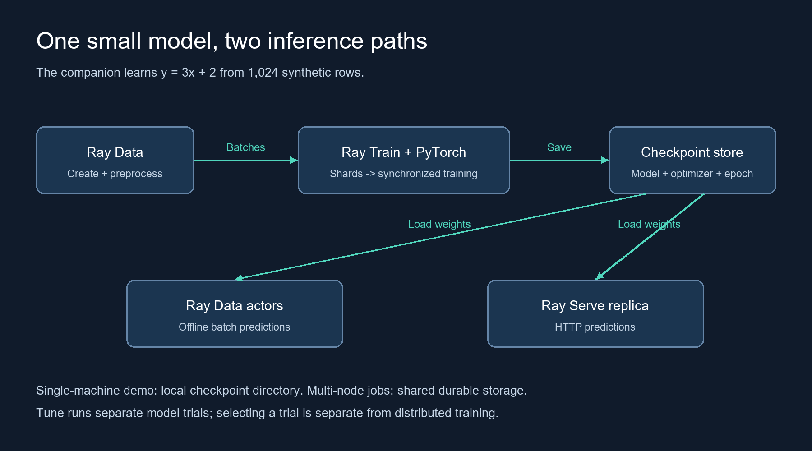
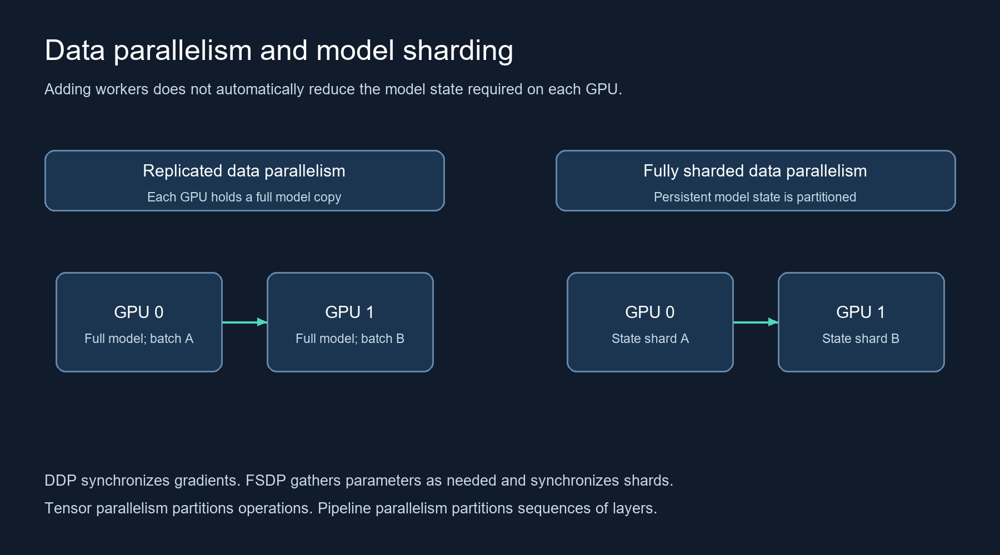
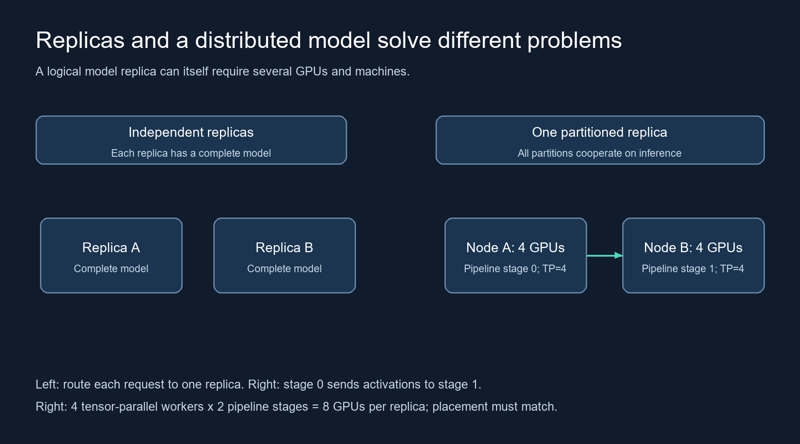

# Scaling Machine Learning with Ray: From One Machine to Distributed Training and Serving

A practical path from CPU tasks to distributed training, checkpoints, and models that require several GPUs.

A machine-learning workload can exceed one machine for several reasons. The dataset can be too large. Training can take too long. The model can exceed the memory of one graphics processing unit (GPU). An inference service can receive more requests than one replica can process.

Each problem needs a different form of parallelism. This tutorial starts with a small regression model, then explains which changes support larger workloads.

Examples use **Ray 2.59.0 and Python 3.11**, verified on 25 October 2026. [Ray release](https://github.com/ray-project/ray/releases/tag/ray-2.59.0).

The complete code is in [RayTutorial on GitHub](https://github.com/Prathmesh333/RayTutorial). Each file below is a separate program. Run the commands from the repository root. [common.py](https://github.com/Prathmesh333/RayTutorial/blob/main/common.py) contains shared initialization and data helpers.

```text
RayTutorial/
  requirements.txt          CPU tutorial dependencies
  requirements-llm.txt      Separate Linux GPU serving dependencies
  common.py                 Shared Ray and data helpers
  local_baseline.py         Train without Ray
  core_tasks.py             Learn tasks and actors
  data_pipeline.py          Create and preprocess data
  gpu_check.py              Check real GPU execution
  train_regression.py       Distributed training and checkpoints
  tune_regression.py        Compare learning rates
  batch_inference.py        Predict batches
  serve_regression.py       Serve the small model
  train_fsdp.py             Two-GPU sharding mechanics
  serve_llm.py              Eight-GPU model-serving configuration
  diagrams/                 PNG diagrams and editable SVG sources
  docs/verification.md      Actual tests and limitations
```

Clone the repository before following the tutorial:

```bash
git clone https://github.com/Prathmesh333/RayTutorial.git
cd RayTutorial
```

The [README](https://github.com/Prathmesh333/RayTutorial#readme) gives each program's purpose, prerequisites, run command, and expected behavior. The [verification report](https://github.com/Prathmesh333/RayTutorial/blob/main/docs/verification.md) separates executed examples from source-reviewed configurations.

CPU walkthrough: [local_baseline.py](https://github.com/Prathmesh333/RayTutorial/blob/main/local_baseline.py), [core_tasks.py](https://github.com/Prathmesh333/RayTutorial/blob/main/core_tasks.py), [data_pipeline.py](https://github.com/Prathmesh333/RayTutorial/blob/main/data_pipeline.py), [tune_regression.py](https://github.com/Prathmesh333/RayTutorial/blob/main/tune_regression.py), [batch_inference.py](https://github.com/Prathmesh333/RayTutorial/blob/main/batch_inference.py), and [serve_regression.py](https://github.com/Prathmesh333/RayTutorial/blob/main/serve_regression.py).

Distributed examples: [gpu_check.py](https://github.com/Prathmesh333/RayTutorial/blob/main/gpu_check.py), [train_regression.py](https://github.com/Prathmesh333/RayTutorial/blob/main/train_regression.py), [train_fsdp.py](https://github.com/Prathmesh333/RayTutorial/blob/main/train_fsdp.py), and [serve_llm.py](https://github.com/Prathmesh333/RayTutorial/blob/main/serve_llm.py). Check their hardware requirements and execution status before running them.

**Execution status:** the plain PyTorch baseline, Ray task and actor checks, data preprocessing, Tune trials, batch inference, and a local Ray Serve HTTP request passed. Ray Train's two-worker test failed during Gloo initialization on the native Windows authoring environment. Its training loop and recovery path were therefore not executed successfully. GPU, FSDP2, multi-node training, and large-model serving configurations were reviewed against versioned sources but not executed. No large-model fit, speedup, or latency result is claimed.

## 1. Understand the boundary between Ray and the model framework

Ray Core schedules Python tasks and actors across a cluster. A task executes a remote function. An actor maintains state inside a remote Python object.

A remote call returns an object reference, or `ObjectRef`. The reference identifies a result that can become available later. `ray.get()` retrieves the result. Ray uses per-node object stores to share supported objects and transfer data between nodes. The object store does not combine GPU memory into one allocation. [Ray objects](https://docs.ray.io/en/latest/ray-core/objects.html).

The head node runs cluster services, including the Global Control Service (GCS). Worker nodes supply additional compute resources. Each node has a raylet that participates in scheduling and resource management. A driver submits the application. A production head node can advertise zero CPUs for user tasks while retaining physical CPUs for cluster services. [Ray cluster concepts](https://docs.ray.io/en/latest/cluster/key-concepts.html).



*One cluster can contain CPU and GPU machines. Model frameworks handle tensor communication between training or inference workers.*

Ray manages the workers and resources. PyTorch manages the neural network, automatic differentiation, and distributed training operations. For large-language-model inference, an engine such as vLLM manages model execution and engine-level batching. Ray does not automatically partition an arbitrary model when another machine joins the cluster.

## 2. Install a small, reproducible environment

Use Python 3.11 for the companion examples. The development environment needs four available central processing unit (CPU) cores and enough memory for Python, PyTorch, and local Ray processes. No model download is required for the regression examples.

Use a virtual environment, then install the pinned dependencies:

```bash
python -m venv .venv
# Linux/macOS:
source .venv/bin/activate
# Windows PowerShell instead:
# .venv\Scripts\Activate.ps1
python -m pip install -r requirements.txt
python -m pip check
```

The direct dependencies are Ray 2.59.0, PyTorch 2.9.0, NumPy 2.2.6, pandas 2.3.3, PyArrow 21.0.0, and protobuf 7.36.2. The package includes the exact authoring-environment dependency snapshot. That snapshot is not a portable GPU lockfile.

The installed Windows PyTorch wheel is CPU-only. GPU examples need a compatible CUDA-enabled PyTorch build, NVIDIA drivers, and Linux for the multi-node path. Ray documents Windows support as beta and experimental support for multi-node Windows clusters. Use the Linux cluster path for this tutorial. [Ray installation and platform support](https://docs.ray.io/en/latest/ray-overview/installation.html).

Run `python local_baseline.py` for the plain PyTorch baseline. It trains the same small regression model without Ray and exports `artifacts/model.pt`. This export also supports the batch and serving examples when distributed training is unavailable. Linux DDP execution remains unverified in this authoring session.

## 3. Submit CPU work without waiting after every submission

Run `python core_tasks.py`. The script compares ordinary Python results with remote task results. It also checks an actor that accumulates a total.

The central part of [core_tasks.py](https://github.com/Prathmesh333/RayTutorial/blob/main/core_tasks.py) is:

```python
import ray

@ray.remote(num_cpus=1)
def square(x):
    return x * x

if __name__ == "__main__":
    ray.init(num_cpus=4, include_dashboard=False)
    try:
        refs = [square.remote(x) for x in range(8)]
        print(ray.get(refs))
    finally:
        ray.shutdown()
```

The expected list is `[0, 1, 4, 9, 16, 25, 36, 49]`. Submitting the tasks before retrieving results permits concurrent execution. Retrieving each result immediately after submitting its task can serialize the loop. This tiny calculation demonstrates scheduling; task overhead can make it slower than ordinary Python. [Ray task patterns](https://docs.ray.io/en/latest/ray-core/patterns/ray-get-loop.html).

`num_cpus=1` declares a logical scheduling requirement. It does not pin a process to a physical core or constrain every library thread. Likewise, `num_gpus=1` reserves a GPU resource for scheduling; it does not partition GPU memory or move tensors automatically. [Ray resource semantics](https://docs.ray.io/en/latest/ray-core/scheduling/resources.html).

For a GPU scheduling check, run `python gpu_check.py` in the GPU environment. The remote function creates a CUDA tensor and returns a checked matrix-product sum. The script skips explicitly if the cluster advertises no GPU. A positive GPU resource count alone does not prove that the CUDA driver and PyTorch build work.

## 4. Create data, preprocess it, and train one model

The example learns `y = 3x + 2`. Ray Data generates 1,024 identifiers. A NumPy transformation converts each identifier into a feature and target. Run `python data_pipeline.py` to check the row count and transformation.

The complete transformation lives in [common.py](https://github.com/Prathmesh333/RayTutorial/blob/main/common.py):

```python
import numpy as np
import ray

def features(batch):
    x = batch["id"].astype(np.float32) / 1023.0 * 2.0 - 1.0
    return {"x": x, "y": 3.0 * x + 2.0}

def dataset():
    return ray.data.range(1024, override_num_blocks=4).map_batches(
        features, batch_format="numpy"
    )
```

For real data, a reader such as `ray.data.read_parquet()` replaces the synthetic source. Every node that performs reads needs access to the data location. A local path on one machine is not automatically available on other machines. Ray Data can stream dataset shards into training workers. [Data loading and training integration](https://docs.ray.io/en/latest/train/user-guides/data-loading-preprocessing.html).



*The same small model connects preprocessing, training, checkpoint storage, batch inference, and online serving.*

Start one-worker training, then use two workers with a new run name:

```bash
python train_regression.py --workers 1 --name cpu-one-worker
python train_regression.py --workers 2 --name cpu-two-workers
```

The training function creates `torch.nn.Linear(1, 1)`. `prepare_model()` places the model on the assigned device and enables DistributedDataParallel (DDP) when multiple workers participate. Each worker reads its own dataset shard. PyTorch synchronizes gradients so the workers update replicas of one model. [Ray PyTorch guide, release-tagged source](https://github.com/ray-project/ray/blob/ray-2.59.0/doc/source/train/getting-started-pytorch.rst).

The worker batch size is 32. With two workers and no gradient accumulation, the effective global batch size is 64. Increasing the worker count changes this batch size unless another setting compensates. It can therefore change learning behavior, even when the code is otherwise identical.

The complete script checks that the worker count divides the toy dataset into equal full batches. Workers must execute compatible collective operations. Unequal iteration counts can leave one worker waiting for another.

The script reports an example-weighted training loss across workers. This loss is a training metric, not evidence of generalization. After training, the driver exports `artifacts/model.pt` for inference.

## 5. Save enough state to resume

[train_regression.py](https://github.com/Prathmesh333/RayTutorial/blob/main/train_regression.py) saves the model, optimizer, and next epoch. Every worker reports once per epoch. Only rank zero writes the checkpoint for this replicated DDP example. This checkpoint pattern does not automatically apply to sharded models. [Ray checkpoint guide](https://docs.ray.io/en/latest/train/user-guides/checkpoints.html).

The script enables `RAY_TRAIN_V2_ENABLED=1` before importing Ray Train. Its `RunConfig` allows one worker-group recovery attempt. The training function calls `ray.train.get_checkpoint()` and restores the saved state when Ray supplies a checkpoint.

For driver recovery, reuse the same storage path and run name. For a new experiment, use a new name. Ray Train V2 uses that identity to locate persisted run state. The tutorial does not use deprecated `TorchTrainer.restore()` calls. [Ray Train recovery](https://docs.ray.io/en/latest/train/user-guides/fault-tolerance.html).

This example resumes at epoch boundaries. It does not promise identical mid-epoch replay or restore every random-number-generator state. A production workload must define its own reproducibility and data-replay requirements.

Local storage is sufficient for the single-machine example. A multi-node job needs durable storage accessible to the driver and workers. The same directory name on two independent disks does not create shared storage.

## 6. Move from one GPU to several machines

Within one machine, `python train_regression.py --workers 2 --gpu --name gpu-two-workers` requests two GPU training workers. Each worker needs one usable GPU. DDP replicates the model; it does not make an oversized model fit.

For several Linux machines, start one Ray head and join worker nodes to that same cluster. The companion README contains the commands and token configuration. The nodes need compatible Python environments, reachable advertised addresses, and the ports required by Ray and the distributed backend. A firewall rule for port 6379 alone is insufficient. [Manual cluster setup](https://docs.ray.io/en/latest/cluster/vms/user-guides/launching-clusters/on-premises.html).

The cluster example advertises zero task CPUs on the head. Two worker machines each advertise four CPUs and one GPU. Launch the training driver on the head with `RAY_ADDRESS=auto`. The script's `SPREAD` placement preference distributes workers when resources permit. A placement preference is not a guarantee of a specific GPU-to-rank topology.

The following launch command assumes that the authenticated cluster, identical environments, and shared checkpoint directory already exist:

```bash
RAY_ADDRESS=auto python train_regression.py \
  --workers 2 --gpu \
  --storage /mnt/shared/ray-runs \
  --name gpu-two-nodes
```

Two independent Ray clusters do not automatically form one training job. Data, checkpoints, and orchestration must connect independent jobs explicitly. Cross-region synchronous training also introduces network latency, bandwidth limits, and failure concerns. The examples here use one cluster in one low-latency network.

## 7. Choose parallelism based on the memory problem



*DDP increases parallel data processing. Full sharding reduces replicated persistent model state, but computation still needs temporary memory.*

**Data parallelism:** each worker holds a model replica and processes different data. DDP synchronizes gradients. The full model must still fit on each worker.

**Fully sharded data parallelism:** model state is partitioned across workers. PyTorch Fully Sharded Data Parallel (FSDP) gathers parameter groups when computation needs them. FSDP2's `fully_shard()` applies sharding to the model, and the optimizer is created afterward. [PyTorch 2.9 FSDP2](https://docs.pytorch.org/docs/2.9/distributed.fsdp.fully_shard.html).

**Tensor parallelism:** workers split tensor operations within model layers. Frequent communication makes interconnect performance important.

**Pipeline parallelism:** workers execute different sequences of layers. Activations move between stages. Stage imbalance and idle pipeline periods can limit throughput. [OpenAI's explanation of large-model training techniques, 9 June 2022](https://openai.com/index/techniques-for-training-large-neural-networks/).

The companion [train_fsdp.py](https://github.com/Prathmesh333/RayTutorial/blob/main/train_fsdp.py) demonstrates FSDP2 mechanics with a small model and two GPUs. Ray Train establishes the worker group. PyTorch creates the device mesh and shards the model. The example does not use `prepare_model()` to wrap the already sharded model in DDP. It is a GPU mechanics example, not a complete huge-model training or checkpointing recipe.

DeepSpeed offers another framework integration. Ray's documentation describes running DeepSpeed inside a Ray Train worker group. The training framework determines the sharding strategy; Ray supplies orchestration. [Ray DeepSpeed integration, release-tagged source](https://github.com/ray-project/ray/blob/ray-2.59.0/doc/source/train/deepspeed.rst).

For memory planning, consider a hypothetical model with 70 billion parameters. Two bytes per stored parameter require approximately 140 GB for weights alone. Gradients at two bytes per parameter add another 140 GB. Two 32-bit floating-point (FP32) Adam moment buffers add approximately 560 GB. An FP32 master-weight copy, when used, adds approximately 280 GB. These assumptions total approximately 1.12 TB before activations, temporary buffers, fragmentation, and communication buffers. These estimates use decimal GB and TB. Different precision and optimizer implementations change the estimate.

Sharding that state across devices changes persistent memory per worker. It does not eliminate peak parameter gathers, activations, or temporary allocations. Dividing the total by the GPU count is not a sufficient capacity test.

## 8. Search hyperparameters separately from worker scaling

Run `python tune_regression.py`. Two independent trials compare learning rates of 0.01 and 0.1. Each trial trains its own model and reports loss on separate evaluation inputs. Ray Tune selects the lower reported validation loss. The example uses synthetic data and does not establish real-world model quality. [Ray Tune guide](https://docs.ray.io/en/latest/tune/getting-started.html).

Trial parallelism and distributed training are different. Two concurrent trials create two models. Two DDP workers cooperate on one model. Combining both dimensions multiplies resource requirements. For example, four concurrent trials with two GPUs each require eight GPUs before other workloads are considered.

## 9. Run batch inference and expose an HTTP endpoint

After training, run `python batch_inference.py`. A Ray Data actor loads the tiny exported model once and predicts batches. The script checks the output count and mean squared error against the known synthetic function. The driver serializes these tiny weights to the actor. Large models should load from a shared model artifact location instead. [Ray Data batch inference](https://docs.ray.io/en/latest/data/batch_inference.html).

For online predictions over Hypertext Transfer Protocol (HTTP), [serve_regression.py](https://github.com/Prathmesh333/RayTutorial/blob/main/serve_regression.py) defines one Ray Serve deployment. Run the following command from the companion directory:

```bash
serve run serve_regression:app
```

Send a request from another terminal:

```bash
curl -X POST http://127.0.0.1:8000/ \
  -H 'Content-Type: application/json' \
  -d '{"x": [0.0, 1.0]}'
```

Predictions should be near 2 and 5 after adequate training. Exact values depend on the trained weights. This local example omits production input validation and authentication. It is not a public-service deployment template. [Ray Serve](https://docs.ray.io/en/latest/serve/).

Adding independent replicas can increase request capacity when resources permit. Each replica still needs enough memory for its model. Replicas do not combine their memory to execute one oversized model.

## 10. Serve a model across GPUs and machines



*A complete-model replica serves requests independently. A partitioned replica needs its participating workers for each distributed inference operation.*

Ray Serve LLM supports tensor and pipeline parallelism through vLLM. The release-tagged cross-node guide documents `tensor_parallel_size`, `pipeline_parallel_size`, and placement-group configuration. [Ray Serve LLM cross-node guide](https://github.com/ray-project/ray/blob/ray-2.59.0/doc/source/serve/llm/user-guides/cross-node-parallelism.md).

Use a separate Linux GPU environment with [requirements-llm.txt](https://github.com/Prathmesh333/RayTutorial/blob/main/requirements-llm.txt). It pins Ray 2.59.0 and vLLM 0.27.0. Ray's own package metadata selects that vLLM release. Do not combine this environment with the tutorial's PyTorch 2.9.0 training environment. vLLM supplies its own PyTorch and CUDA dependency requirements.

The complete [serve_llm.py](https://github.com/Prathmesh333/RayTutorial/blob/main/serve_llm.py) configuration targets `Qwen/Qwen2.5-72B-Instruct`. One logical replica requests tensor parallelism of four and pipeline parallelism of two: eight GPU workers in total. The fixed replica count prevents this example from requesting an additional eight-GPU replica through autoscaling.

The relevant settings from that file are:

```python
engine_kwargs={
    "tensor_parallel_size": 4,
    "pipeline_parallel_size": 2,
    "distributed_executor_backend": "ray",
    "dtype": "bfloat16",
    "max_model_len": 4096,
    "gpu_memory_utilization": 0.85,
}
```

This block is an excerpt, not a standalone program. The companion file includes imports, model loading, deployment settings, and application construction. Launch it with `serve run serve_llm:app` only after the GPU environment and cluster are ready.

On two nodes with exactly four available GPUs each, the eight workers require both nodes. `PACK` prefers fewer nodes, but it does not guarantee a particular rank-to-node assignment. Confirm placement in the engine logs. The diagram illustrates the intended arrangement, not a placement guarantee.

The model repository must be accessible from participating machines. Model downloads, host memory, disk space, GPU memory, and inter-node communication all affect startup. Weights are only part of inference memory: the key-value (KV) cache stores attention state and grows with workload characteristics. Engine workspaces and communication buffers also consume memory. A 4,096-token context setting and an 85-percent memory-utilization setting do not prove that a model fits.

Ray Serve routes requests to the logical model deployment. vLLM executes the model across its participating workers and manages engine-level batching. More independent model replicas require another full set of partition workers. Slow links can make cross-node inference unsuitable for a latency-sensitive service. Measure time to first token, output-token rate, tail latency, and memory under the intended concurrency. [vLLM distributed serving](https://docs.vllm.ai/en/latest/serving/parallelism_scaling/).

## 11. Operate the workload within explicit limits

The Ray dashboard and `ray status` help distinguish queued work from running work. Look for unavailable resource bundles, high object-store usage, slow data reads, idle GPUs, and workers that exit. A pending task can indicate an unsatisfied resource request rather than a slow model. [Ray observability](https://docs.ray.io/en/latest/ray-observability/getting-started.html).

CPU preprocessing can limit GPU utilization. Small tasks can spend more time scheduling than computing. Excessive retained object references can increase memory pressure. Large training batches can exhaust activation memory even when model weights fit.

Autoscaling needs a configured infrastructure provider or cluster operator. `num_workers=8` requests workers; it does not independently purchase eight machines. Separate replica autoscaling from cluster-node autoscaling. For Kubernetes deployments, evaluate KubeRay and its resource configuration. [Ray autoscaling](https://docs.ray.io/en/latest/cluster/vms/user-guides/configuring-autoscaling.html).

Ray 2.59 enables token authentication by default for newly initialized local clusters. Manual remote clusters still need explicit token configuration. Configure the same secret on participating nodes and clients, protect the network, and avoid exposing Ray management endpoints directly to the internet. Tokens alone do not encrypt traffic. [Ray token authentication](https://docs.ray.io/en/latest/ray-security/token-auth.html).

Count storage, data transfer, checkpoint traffic, idle replicas, and recovery time when estimating cost. A sharded job can lose progress when one participating worker fails. Checkpoints reduce recoverable work loss, but replacement capacity and storage bandwidth still affect recovery time.

For cleanup, stop the foreground `serve run` command. Run `serve shutdown` to remove deployments from the selected development cluster. The Python scripts call `ray.shutdown()` to disconnect; this does not tear down a separately started cluster. On each dedicated tutorial node, run `ray stop` when finished. These commands do not delete external checkpoint storage or terminate cloud instances.

## 12. What the company examples establish

**OpenAI, historical evidence:** Anyscale's 16 February 2023 recap links Greg Brockman's Ray Summit 2022 discussion. The recap describes Ray's role in OpenAI's distributed platform and large-model training. This supports historical use. It does not establish which current model uses Ray or disclose a current training topology. [Conference recap and linked speaker clips](https://www.anyscale.com/blog/ray-summit-2022-stories-large-language-models).

**Uber, 9 January 2025:** Uber describes using Ray for parallel optimization tasks in its rides marketplace. Its design combines Spark data processing with Ray execution of general Python work. This example shows that Ray's role extends beyond neural-network training. It does not establish a speedup for the tutorial workload. [Uber engineering](https://www.uber.com/in/en/blog/how-uber-uses-ray-to-optimize-the-rides-business/).

**Shopify, 10 March 2023:** Shopify describes extending its Ray-based Merlin platform with online inference. This is a dated account of its platform, not confirmation of its current architecture. [Shopify engineering](https://shopify.engineering/shopifys-machine-learning-platform-real-time-predictions).

Other applications include distributed simulation, reinforcement learning with RLlib, feature processing, model evaluation, embeddings, and independent experiment execution. The useful primitive is the same: explicit units of work, declared resources, and controlled data movement. [Ray use cases](https://docs.ray.io/en/latest/ray-overview/use-cases.html), [RLlib](https://docs.ray.io/en/latest/rllib/index.html).

Start with the small workload and identify the limiting resource. Add data-parallel workers when the model fits and training throughput is the problem. Use an explicit sharding strategy when model state exceeds device memory. For serving, decide whether you need more independent replicas or one model distributed across devices. That decision determines the architecture before a GPU count does.

